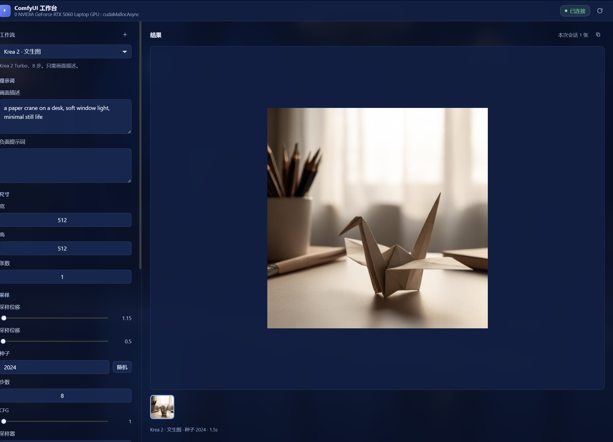

# ComfyUI Studio · DeepSeek Harness plugin

[](https://github.com/W3967/dsh-comfyui-panel/actions/workflows/test.yml)

[中文](README.md) | English

Plug a local **ComfyUI** into DeepSeek Harness: import any API-format workflow, get a parameter form generated from the graph, and generate from the sidebar.

Running ComfyUI normally means switching to a browser, editing parameters in a node graph, then switching back. This plugin folds all of that into the DSH sidebar: the form stays put and the images land next to your conversation.

Two **Krea 2** presets ship built in (text-to-image and style reference), so it works out of the box; everything else works as soon as ComfyUI can run it.



---

## It is generic, not Krea 2 specific

The core is not a particular model, it is **parameter discovery**: ComfyUI's own `/object_info` is used as metadata to translate any workflow graph into a form.

| Where the information comes from | What it decides |
|---|---|
| `/object_info` | Whether an input becomes a dropdown, slider, number box or text area; its range; its choices |
| The graph's links | Which of two `CLIPTextEncode` nodes is the positive prompt and which is the negative |
| A ~60-line semantic rule table | Readable labels and grouping: "Prompt", "Steps", "UNet" |
| Equal-value folding | The `width` that both `EmptyLatentImage` and `ModelSamplingFlux` carry becomes one control |

A node class the rules do not recognise is not an error — it degrades to a generic `Class · field` control. Install whatever custom nodes you like.

## Features

- **Import any workflow**: paste the JSON from ComfyUI's "Save (API Format)" and a form appears.
- **Krea 2 built in**: text-to-image and style-reference presets, ready on install.
- **Two entry points**: click in the panel, or let the model call the agent tool; both share one job queue.
- **Automatic parameter detection**: prompts, seed, steps, CFG, size, models, LoRA strength, image inputs.
- **Job-based generation**: submit returns immediately, the panel polls progress, cancellation works, results open full size.
- **Queue**: see every task ComfyUI has queued, not just this plugin's; drop pending items or clear them.
- **History**: browse every image in the `output/` folder; open one full size, **restore the parameters it was generated with**, reveal it in Explorer, or delete it.
- **Parameter presets**: save the current set of values under a name and reapply it later.
- **Start and stop from the panel**: launch ComfyUI when it is not running; stop it when you are done — models unload first (freeing VRAM), then the process stops.
- **Follows the host theme**: only `--dsw-alias-*` design tokens.

## Requirements

1. **ComfyUI** running (default `http://127.0.0.1:8188`), version 0.26.0 or newer recommended.
2. **GPU**: whatever your workflow needs. The built-in Krea 2 preset runs Q2_K on 8 GB of VRAM (1024² at 8 steps, about 70 s).
3. **A workflow that already works**: confirm it produces an image in the ComfyUI web UI first.

## Optional: run ComfyUI in the background

> If you only use ComfyUI from DSH, the **start button** in the panel is enough — it appears whenever ComfyUI is not running. This section is for "keep it running on its own / without opening the panel".

The portable ComfyUI opens a console window when you double-click `run_nvidia_gpu.bat`, and **closing that window stops the server** — a trap most people hit once.

[docs/comfyui/](docs/comfyui/) holds two small scripts. Copy them into the portable ComfyUI root (next to `run_nvidia_gpu.bat`); they resolve their own folder, so nothing needs editing:

| File | Purpose |
|---|---|
| `start-silent.vbs` | double-click to start with no window at all |
| `stop.bat` | double-click to stop; matches only the ComfyUI process, other Python processes are left alone |

Output goes to `comfyui.log` in the same folder. Keep `run_nvidia_gpu.bat` around for when you need live logs.

Both scripts are a dozen lines each: start `ComfyUI\main.py` through `python.exe` with the window hidden and redirect the output. Read them before trusting them.

## Install

### Option 1: local directory (development)

```bash
git clone https://github.com/W3967/dsh-comfyui-panel.git
```

In Harness, run `plugin_manager` with `install_bundle` and pass the absolute path of that directory.

### Option 2: mount it into the profile

Put the package in the profile's `node_modules` and add one row to `cordis.patch.yml`:

```yaml
- insert:
    - id: krea2
      name: dsh-comfyui-panel
      config:
        comfyUrl: 'http://127.0.0.1:8188'
        comfyRoot: 'D:\AI\ComfyUI\ComfyUI_windows_portable\ComfyUI'
```

`config` is only a **seed**: values saved from the panel take precedence.

## Configure

A ✦ icon appears in the sidebar. Expand «Settings» at the bottom:

| Field | Meaning |
|---|---|
| ComfyUI URL | Default `http://127.0.0.1:8188`; reverse-proxied paths such as `http://host/comfy` also work. |
| ComfyUI directory | The folder containing `models/`, `input/` and `output/`. **Required**, otherwise generated images cannot be read back and input images cannot be copied in. |

## Quick start

1. Pick **Krea 2 · Text to image** in the workflow dropdown.
2. Write a prompt (English works best).
3. Make sure the UNet dropdown resolved to a file.
4. Press Generate (or `Ctrl/Cmd + Enter`).
5. The image appears on the right; click it for full size, the thumbnail strip walks back through this session.

Parameter values save automatically and come back next time.

## Import your own workflow

### 1. Export from ComfyUI

Build the graph, confirm it generates, then use **Workflow → Save (API Format)**.

> Only **API Format** is accepted. The UI-format export (the file with `nodes` / `links` arrays) is for the browser and cannot be parsed here.

### 2. Paste it into the panel

Press **+** next to the workflow dropdown, give it a name, paste the whole JSON, hit Import.

### 3. The form builds itself

Parameters are discovered immediately. For the Krea 2 text-to-image preset, 18 parameters come back in four groups:

```
Prompt    Prompt · Negative prompt
Size      Width · Height · Batch size      (width and height each fold two nodes)
Sampling  Seed · Steps · CFG · Sampler · Scheduler · Denoise · Shift max/base
Models    UNet · Text encoder · CLIP type · VAE · LoRA
```

Image inputs (`LoadImage`) become path boxes with a «Use latest» button that fills in the image you just generated.

### 4. What about parameters it cannot name?

They land in «Other» labelled like `SomeNode · some_field`, and the control still works. Two ways to improve that:

- add one matching rule to `RULES` in [lib/workflows.js](lib/workflows.js)
- or leave it — functionality is unaffected

## How parameters are found

Four steps, all in `discoverParams()` in [lib/workflows.js](lib/workflows.js):

1. **Skip links**: `inputs: { model: ["7", 0] }` references another node, it is not a parameter.
2. **Read the declaration**: the `[type, options]` pair from `/object_info` picks the widget, range and choices.
3. **Attach semantics**: a "class + field name" rule table turns `KSampler.steps` into "Steps".
4. **Fold equal values**: inputs with the same semantics and the same value share one control that writes to every owner.

Positive and negative prompts are not guessed: the algorithm follows the sampler's `positive` / `negative` links and labels the nodes they point at.

## For the agent

Two agent tools are registered:

| Tool | Purpose |
|---|---|
| `krea2_workflows` | List workflows and their parameters (id, label, control, value, choices) |
| `krea2_generate` | Submit a generation, wait for the image, return its absolute path |

The model looks up parameter names first, then submits:

```json
{
  "workflow": "krea2-txt2img",
  "values": { "4.text": "a red fox in snow", "8.steps": 12, "6.width": 768 }
}
```

Keys are the `params[].id` values returned by `krea2_workflows`.

How it relates to the panel:

- **Same validation and clamping** — there is no second code path.
- **Serial execution** (`isConcurrencySafe: false`): concurrent runs fight over VRAM, and ComfyUI's `/interrupt` is global.
- **Cancellable** — an interrupted model call releases the wait through `exec.signal`.
- **11-minute tool timeout**, a little longer than the 10-minute job cap, so you get "job failed" rather than "tool timed out".

## Relationship to krea2-mcp

Same backend, two front ends. **Install one, not both:**

- **This plugin** — DeepSeek Harness only, panel plus tools.
- **`krea2-mcp`** — a plain MCP server with tools only, usable from any MCP client.

Installing both leaves two near-identical capabilities in the tool list, the model picks either at random, and both fight over the GPU. Inside DSH the plugin is enough.

## Architecture

```
comfyui-panel/
├── index.js              Host half: wires settings, presets, routes, tools
├── lib/
│   ├── comfy.js          ComfyUI HTTP client (contains no node graph at all)
│   ├── workflows.js      Parameter discovery, graph merging, presets, storage
│   ├── settings.js       Connection info + active workflow + per-workflow values
│   ├── presets.js        Parameter presets (a set of values, not a graph)
│   ├── jobs.js           Job state machine (submit, poll, cancel)
│   ├── routes.js         /krea2/* routes, object_info cache, image path checks
│   ├── recover.js        Reads the graph a PNG carries and restores its values
│   ├── launch.js         Starts a local ComfyUI when it is not running
│   └── tool.js           krea2_workflows / krea2_generate
├── client.js             Sidebar entry + main panel (dynamic form)
├── cordis.patch.yml      bundle patch
├── locale/{en,zh}.json   title and description in Plugin Manager
├── docs/panel.png        screenshot
└── icon.svg
```

**The only graph-shaped data** is `BUILTIN_PRESETS` in `workflows.js` — two static Krea 2 JSONs. Nothing else knows about models or architectures.

**Endpoints**:

| Method | Path | Purpose |
|---|---|---|
| GET | `/krea2/status` | ComfyUI state, preset list, current settings |
| POST | `/krea2/start` | Start a local portable ComfyUI |
| POST | `/krea2/stop` | Unload models and stop that ComfyUI |
| GET | `/krea2/workflow?id=` | Discovered parameters and saved values for one preset |
| POST | `/krea2/workflow` | Create or replace a user preset |
| DELETE | `/krea2/workflow?id=` | Delete a user preset |
| GET/POST | `/krea2/settings` | Read / partially update settings |
| POST | `/krea2/generate` | Submit one generation, returns a job immediately |
| GET | `/krea2/job?id=` | One job's state |
| GET | `/krea2/jobs` | Recent jobs |
| POST | `/krea2/cancel` | Stop a job |
| GET | `/krea2/queue` | ComfyUI queue (running + pending) |
| POST | `/krea2/queue` | Remove pending items or clear the queue |
| GET | `/krea2/history?limit=` | Scan the `output/` folder for images |
| GET | `/krea2/recover?path=` | Recover a generation's parameters from PNG metadata |
| POST | `/krea2/reveal` | Reveal a file in Explorer |
| DELETE | `/krea2/image?path=` | Delete one generated image |
| GET/POST | `/krea2/presets` | Read / save parameter presets |
| DELETE | `/krea2/presets?id=` | Delete a parameter preset |
| GET | `/krea2/image?path=` | Image bytes |

`?path=` is re-resolved and must land inside ComfyUI's `output` or `temp`; traversal and outside paths are a flat 404.

The browser calls these with relative paths — `fetch('krea2/...', { credentials: 'same-origin' })` — and images are proxied by the Host, so the browser never talks to ComfyUI directly.

## Development

```bash
npm run check   # node --check on all 8 entry files
npm test        # 25 tests: discovery, merging, path safety, tool arguments
```

No build step: `client.js` is plain JavaScript the browser loads directly (`window.__ModuleLoader__` format), so a page refresh picks up changes.

After editing `index.js` or anything under `lib/`, disable and re-enable the plugin from `plugin_manager` so a fresh module generation is loaded.

### CI

GitHub Actions runs `npm run check` and `npm test` on every push and pull request (Node 22, about 15 seconds). The badge is at the top of this page.

### Publishing

```bash
git init
git add -A
git commit -m "feat: generic ComfyUI front end for DeepSeek Harness"

git remote add origin https://github.com/W3967/dsh-comfyui-panel.git
git branch -M main
git push -u origin main
```

## Known limitations

- **API format only**. The UI-format JSON (with `nodes` / `links`) is not parsed.
- **Complex workflows produce ugly forms**: multi-stage sampling, masks and branching graphs degrade into a pile of `Class · field` controls. Functional, not pretty.
- **One output node**: when a workflow has several `SaveImage` nodes, only the first one's images are shown.
- **Cancellation is best effort**: ComfyUI's `/interrupt` is global, so a prompt already sampling may still finish while the panel marks it canceled.
- One generation is capped at 10 minutes.
- Image inputs take an absolute local path; drag-and-drop upload is not supported yet.
- **ComfyUI caches executions**: a second submission with identical parameters reuses the previous output and can return in a second or two (that is where the "1.5s" in the screenshot comes from). That is ComfyUI's own behaviour — change the seed or a single word and it recomputes.
- Image management covers the `output/` folder only: delete and reveal in Explorer work, rename and move do not.
- **Start/stop is local only**: starting also requires the portable build (a `python_embeded/` next to the directory); source installs, conda environments and remote ComfyUI manage their own process.
- Stopping checks the queue first: any running job — this plugin's or anything else in ComfyUI's queue — makes it refuse with HTTP 409, so it never kills work in progress.

## Notes

- **Model weights carry their own licences**. The built-in Krea 2 presets correspond to the Krea 2 Community License (conditional commercial use, mandatory content-filtering obligations). This plugin ships no model weights.

## License

MIT for the plugin code. See [LICENSE](./LICENSE).
