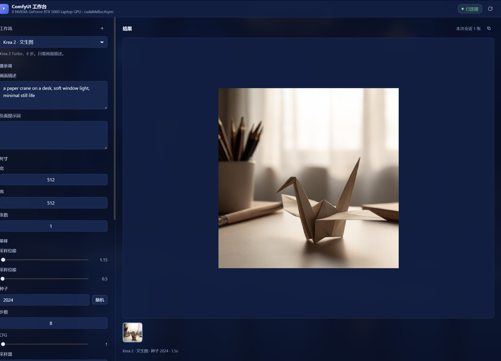

# Krea 2 Studio · DSH 插件

中文 | [English](README.en.md)

把本机 **Krea 2（ComfyUI）** 接进 DeepSeek Harness：侧栏点一下，选模型、写描述、调参数，直接出图。

A DeepSeek Harness plugin that turns a local ComfyUI running Krea 2 into a sidebar panel: pick the quantized UNet and LoRA, tune size / steps / seed, and generate without leaving the app.



---

## 特性

- **侧栏入口 + 独立面板**：不占对话空间，和聊天并排使用。
- **模型选择**：自动扫描 `<ComfyUI>/models`，下拉切换量化 UNet（含 GGUF）、文本编码器、VAE、LoRA。
- **两种模式**：
  - 文生图（txt2img）：只凭描述生成。
  - 风格参考（style_ref）：给一张参考图，沿用它的风格与氛围；可一键把刚才的结果当参考图。
- **参数可调**：尺寸预设 / 自定义宽高、步数、CFG、种子（留空随机）、采样器、LoRA 强度、ModelSamplingFlux 的 max/base shift。
- **设置持久化**：ComfyUI 地址与目录存在 `$DSH_HOME/krea2-panel/settings.json`，重启后仍在。
- **任务式生成**：提交后立刻返回，面板轮询进度，支持取消；完成后可看大图、复制路径。
- **跟随宿主主题**：只用 `--dsw-alias-*` 设计令牌，亮色/暗色主题自动适配。
- **Agent 工具**：`krea2_generate`，让模型直接出图并拿到结果路径，和面板共用同一条任务队列。

## 前置条件

1. **ComfyUI** 在跑（默认 `http://127.0.0.1:8188`）。
2. **Krea 2 所需的节点与模型**已装好，面板默认按下面这套工作流对接：
   - `UnetLoaderGGUF`（GGUF 量化主模型）
   - `CLIPLoader`（`type: krea2`）
   - `VAELoader`
   - `LoraLoaderModelOnly`（风格参考 LoRA）
   - `ModelSamplingFlux` / `KSampler`（文生图）
   - `TextEncodeQwenImageEditPlus` / `SamplerCustomAdvanced`（风格参考）

   工作流写在 `lib/comfy.js` 里，是可读的普通对象；如果你的节点名或连线不同，直接改那两处 `buildTxt2Img` / `buildStyleRef`。

## 装哪个：插件版 vs MCP 版

同一套 ComfyUI 工作流有两个前端，**只需要装一个**：

- **本插件（`dsh-krea2-panel`）** —— DSH 专属，带侧栏面板 + agent 工具。
- **`krea2-mcp`** —— 纯 MCP server，只有工具，没有界面。

两者驱动的是同一套 Krea 2 图（同一个 UNet / 文本编码器 / VAE / LoRA），差别在能怎么用：

| | 本插件 | krea2-mcp |
|---|---|---|
| 形态 | Cordis bundle：面板 + 工具 | 纯 MCP server：只有工具 |
| 谁能用 | 只有 DeepSeek Harness | 任何 MCP 客户端（Claude Desktop / Cursor / DSH …） |
| 给人用 | ✅ 点面板调参数、看大图、翻本次会话的历史 | ❌ 只能通过聊天让模型代调 |
| 给模型用 | `krea2_generate` | `generate_image`（DSH 里显示为 `mcp__krea2__generate_image`，其他客户端前缀不同） |
| 选模型 | 扫描 `models/` 下拉切换 | 环境变量写死一个 |
| 可调参数 | 步数 / CFG / LoRA 强度 / 采样器 / ModelSamplingFlux 位移 / 尺寸预设 | prompt / 模式 / 宽高 / seed |
| 进度与取消 | ✅ 任务队列、轮询、可取消 | ❌ 一次调用阻塞到结束 |
| 配置在哪 | 面板「设置」→ `$DSH_HOME/krea2-panel/settings.json` | 环境变量 / CLI flag（DSH 里写进 patch 的 `env`） |
| 额外依赖 | 无（工作流内嵌在包里） | 无 npm 依赖，Node ≥ 18 |

**在 DSH 里用插件版就够了，不要两个都装。** 插件版基本是 MCP 版的超集：工具能做的面板能做，面板能做的工具也能做。MCP 版唯一的额外能力是一个 `comfyui_status` 工具，而插件版对应的是面板顶部的状态徽章和 `GET /krea2/status`（带显存、版本、模型清单）。

### 什么时候仍然选 MCP 版

- 你在**多个 MCP 客户端**之间共用配置（Cursor / Claude Desktop / DSH 都要用），MCP 版写一份 JSON 就够。
- 你**不想要 UI**，或者跑在 headless / 远程无浏览器的环境里。
- 你的 DSH 版本装不了 Cordis bundle。

### 两个都装会怎样

技术上不冲突（工具名不同、各自独立进程），但实际会让人和模型都犯难：

- 工具列表里出现两个几乎相同的能力，模型挑哪个都不算错，结果随机；
- 两条链路各自向 ComfyUI 提交任务，同时跑会抢 8 GB 显存；
- 模型名和地址分两处配置，改了一边忘了另一边，表现就是「面板能出图、模型调不动」，很难查。

如果之前装过 MCP 版，在 `cordis.patch.yml` 里把这段删掉或注释掉即可：

```yaml
# 停用 MCP 版，避免和插件版的 krea2_generate 重复
# - insert:
#     - id: mcp-krea2
#       name: '@deepseek-ai/dsh-mcp-client'
#       config:
#         serverName: krea2
#         transport: stdio
#         command: 'node'
#         args: ['D:/path/to/krea2-mcp/src/index.js']
```

## 安装

### 方式一：本地目录（开发用）

```bash
git clone https://github.com/W3967/dsh-krea2-panel.git
```

在 Harness 里用 `plugin_manager` 的 `install_bundle`，目标填这个目录的绝对路径。本地目录安装是链接检出目录，改完代码重启会话即可生效。

### 方式二：手动挂到 profile

把包放进 profile 的 `node_modules`，并在 `cordis.patch.yml` 里加一行：

```yaml
- insert:
    - id: krea2
      name: dsh-krea2-panel
      config:
        comfyUrl: 'http://127.0.0.1:8188'
        comfyRoot: 'D:\AI\ComfyUI\ComfyUI_windows_portable\ComfyUI'
```

`config` 只是**初始种子**：面板里保存过的值优先于它。

## 配置

装好后侧栏会出现 ✦ 图标，点开就是面板。展开底部的「设置」：

| 项 | 说明 |
|---|---|
| ComfyUI 地址 | 默认 `http://127.0.0.1:8188`，反代路径（如 `http://host/comfy`）也支持。 |
| ComfyUI 目录 | 指向含 `models/`、`input/`、`output/` 的那一层。**必填**，否则模型下拉为空、也读不到生成的图。 |
| 采样器 | `euler` / `euler_ancestral` / `dpmpp_2m` / `dpmpp_2m_sde` / `dpmpp_sde` / `heun` / `lcm`。 |

其余参数（模型、尺寸、步数、CFG、LoRA 强度、CFG 之外的高级项）改动后自动保存，脚注会闪一下「已保存」。

## 使用

1. 选模式：文生图或风格参考。
2. 写画面描述（英文效果最好，中文也能识别）。
3. 选主模型（必填）——其余下拉会自动跟随可用文件。
4. 调尺寸与步数。RTX 5060 8 GB 上 1024² / 8 步约 70 秒；风格参考因为要编码参考图，通常更久。
5. 点「生成」（或 `Ctrl/Cmd + Enter`）。
6. 结果出现在右侧，点图看大图，缩略图条可回看本次会话的历史结果。

## 换模型

面板里那四个下拉全部来自对 ComfyUI `models/` 的**实时扫描**，换模型不用改代码、不用重装插件：

1. 把文件放进对应目录
2. 点面板右上角的 ↻
3. 在下拉里选中它（自动保存）

| 类型 | 放这里 |
|---|---|
| 主模型（UNet） | `models/diffusion_models/`（或 `unet/`） |
| 文本编码器 | `models/text_encoders/` |
| VAE | `models/vae/` |
| LoRA | `models/loras/` |

### 主模型两种格式，自动适配加载器

| 文件 | 加载节点 |
|---|---|
| `*.gguf`（社区量化） | `UnetLoaderGGUF` |
| `*.safetensors`（官方全精度） | `UNETLoader` |

扩展名决定用哪个加载器，所以「Q2_K 换 Q4_K」和「换成官方 fp16 文件」都只是换个下拉选项的事。

### 什么能换、什么不能换

| 变化 | 可行 | 说明 |
|---|---|---|
| 同架构换量化档位（Q2_K → Q4_K → Q8_0） | ✅ | 直接选 |
| 换成官方 `.safetensors` 全精度 UNet | ✅ | 自动切到 `UNETLoader` |
| 换 VAE | ✅ | 需与模型架构匹配（Krea 2 用 `qwen_image_vae`） |
| 加一个风格 LoRA / 换 LoRA | ✅ | 只有**单槽位**，不支持多 LoRA 叠加 |
| 换文本编码器 | ⚠️ | 必须是**官方 FP8 Qwen3VL**；用 GGUF 版会报 `12x2560` 特征维度错误 |
| 换成 Flux / SDXL 等其它架构 | ❌ | 节点图不同，见下 |

**为什么最后一条不行**：工作流的节点图是写死的——`ModelSamplingFlux` + `KSampler`、`CLIPLoader` 的 `type: krea2`、风格参考模式的 `TextEncodeQwenImageEditPlus`。这些是 Krea 2 / Qwen-Image 系列的专用节点，换架构等于换整张图。

要支持别的架构，改 [lib/comfy.js](lib/comfy.js) 里的 `buildTxt2Img` / `buildStyleRef` 两个函数即可，其余部分（排队、参数校验、UI、工具）都不用动。

## 给模型用：`krea2_generate`

> 如果你同时装了 `krea2-mcp`，先看上一节「装哪个」——两个工具会打架。

面板之外，插件还注册了一个 agent 工具。它走**同一条任务队列**（`jobs.start`），只是会等到图片真正产出再返回——模型没法轮询 job id，所以工具把这次调用挂到结束为止。

| 参数 | 说明 |
|---|---|
| `prompt` | 画面描述。`style_ref` 模式下可传空字符串。 |
| `mode` | `txt2img`（默认）/ `style_ref` |
| `reference_image` | `style_ref` 必填，参考图绝对路径 |
| `model` | 可选，临时覆盖 UNet 文件名 |
| `lora` / `lora_strength` | 可选，覆盖 LoRA；`lora: ""` 表示这次不用 |
| `width` / `height` / `steps` / `seed` | 可选，不传沿用面板里的设置 |

返回 `{ path, paths, seed, width, height, steps, elapsed_ms, job_id }`，卡片上直接给图片路径。

和面板的关系：

- **同一套参数校验和钳制**——工具里传 `width: 100` 一样会被夹到 256。
- **串行执行**（`isConcurrencySafe: false`）：两个提示同时跑会抢 8 GB 显存，而 ComfyUI 的 `/interrupt` 是全局的。
- **可取消**：模型侧中断时通过 `exec.signal` 把等待松开。
- **工具超时 11 分钟**，比任务自身的 10 分钟上限略长，保证先拿到「任务失败」而不是「工具超时」。

## 架构

```
krea2-panel/
├── index.js              Host 半：注册 /krea2 路由
├── lib/
│   ├── comfy.js          ComfyUI HTTP 客户端 + 两份工作流图
│   ├── settings.js       设置默认值、校验、落盘
│   ├── jobs.js           任务状态机（queued→running→done/error/canceled）
│   ├── routes.js         /krea2/* 的 HTTP 接口与图片安全校验
│   └── tool.js           krea2_generate agent 工具
├── client.js             Client 半：侧栏图标 + 主面板
├── cordis.patch.yml      bundle 补丁
├── locale/{en,zh}.json   Plugin Manager 里显示的标题与描述
└── icon.svg
```

**通信**：Client 用相对路径 `fetch('krea2/...', { credentials: 'same-origin' })` 调 Host 的 HTTP 路由，不经过会话、不写事件日志。图片也由 Host 代理返回，浏览器不直连 ComfyUI（避免跨域）。

**接口**：

| 方法 | 路径 | 作用 |
|---|---|---|
| GET | `/krea2/status` | ComfyUI 状态、模型清单、当前设置 |
| GET/POST | `/krea2/settings` | 读 / 局部更新设置 |
| POST | `/krea2/generate` | 提交一次生成，立刻返回 job |
| GET | `/krea2/job?id=` | 单个任务状态 |
| GET | `/krea2/jobs` | 最近任务 |
| POST | `/krea2/cancel` | 取消任务 |
| GET | `/krea2/image?path=` | 生成图字节流 |

`?path=` 会重新解析并校验落在 ComfyUI 的 `output` / `temp` 之内，`..` 穿越与外部路径一律 404。

## 开发

```bash
npm run check   # node --check 所有入口
npm test        # 工作流构建 + 路径安全
```

无构建步骤：`client.js` 是直接被浏览器加载的普通 JS（`window.__ModuleLoader__` 格式），改完刷新页面即可。

Host 侧改了 `index.js` 或 `lib/` 之后，用 `plugin_manager` 把这个插件禁用再启用一次，新模块才会加载。

### 发布

```bash
git init
git add -A
git commit -m "feat: Krea 2 studio panel"

git remote add origin https://github.com/W3967/dsh-krea2-panel.git
git branch -M main
git push -u origin main
```

要发 npm 的话，把 `package.json` 的 `"private": true`（若有）去掉，`npm pack --dry-run` 确认打包内容，再 `npm publish --access public`。

## 已知限制

- 取消是「尽力而为」：ComfyUI 的 `/interrupt` 是全局的，已经进入采样的任务可能仍会跑完，面板会立刻标为已取消。
- 单次生成上限 10 分钟，超时判失败。
- 参考图只接受本机绝对路径（面板会把它复制进 ComfyUI 的 `input`），暂不支持拖拽上传。
- 面板本身不做图片管理；生成的图留在 ComfyUI 的 `output` 目录。

## 注意事项

- **Krea 2 模型本身**适用 Krea 2 Community License（商用有条件、有内容过滤义务）。本插件只是调用你的本地 ComfyUI，不附带任何模型权重。

## License

MIT（插件代码）。见 [LICENSE](./LICENSE)。
